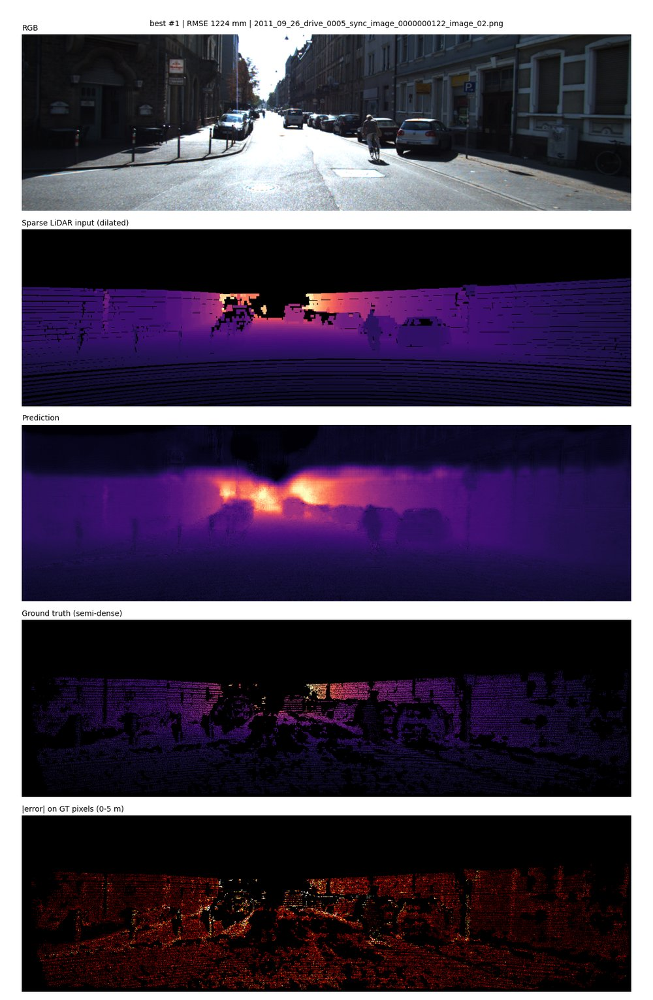
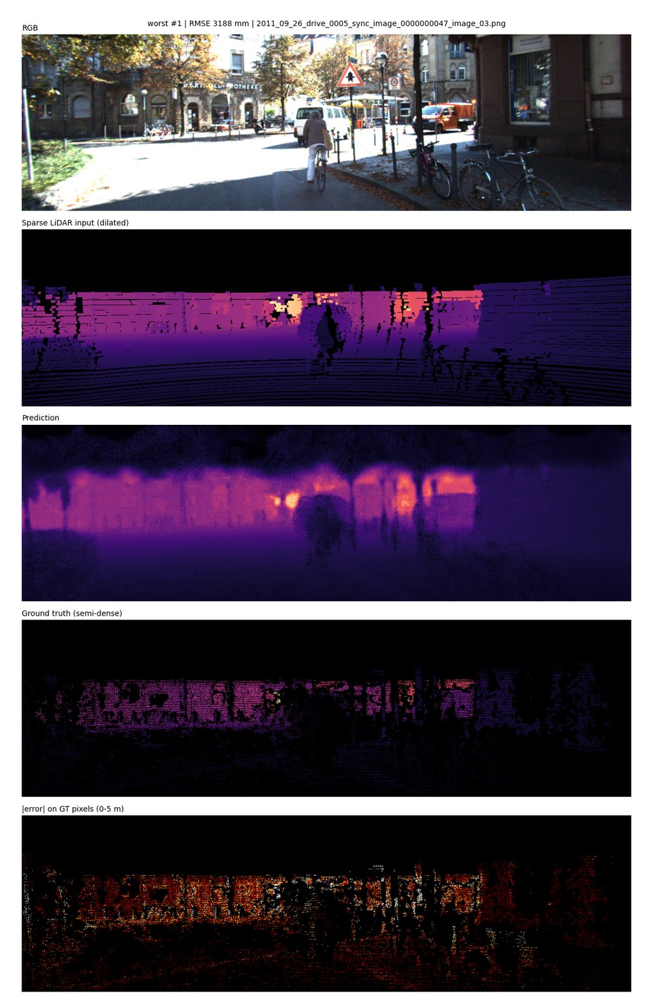
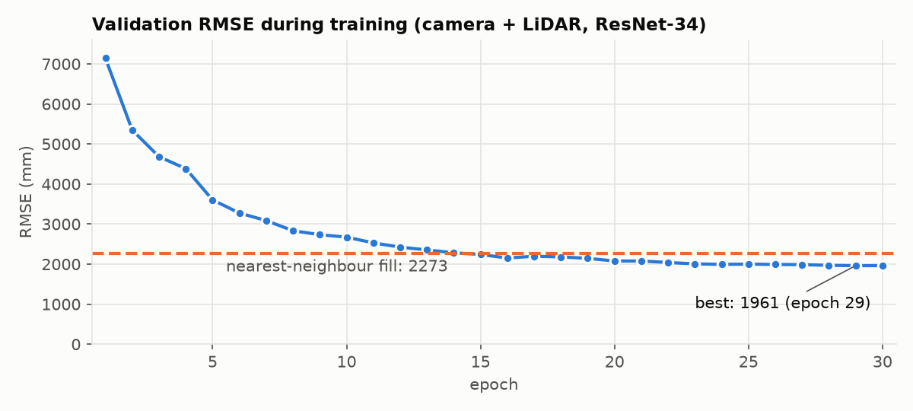
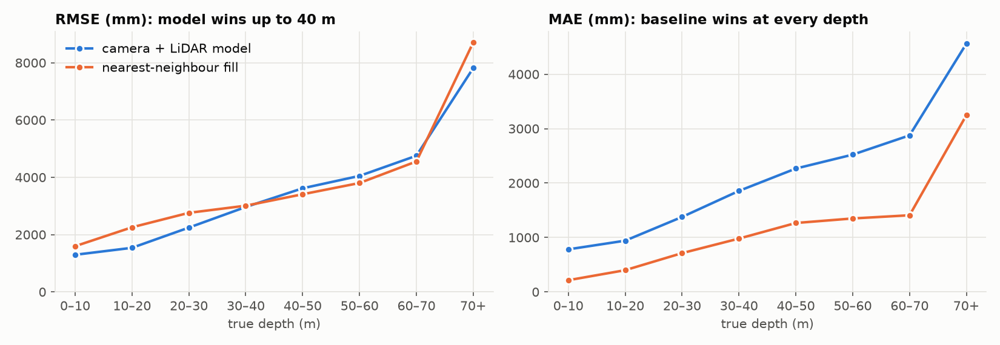
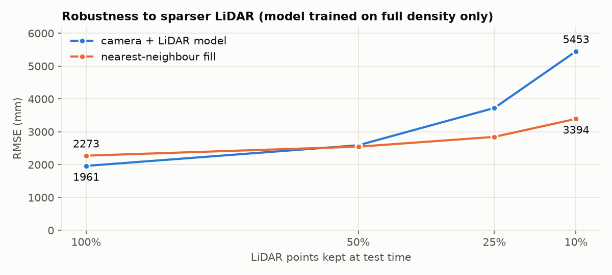

# Sparse-to-Dense: camera + LiDAR depth completion on KITTI

Implementation of the supervised model from

> F. Ma, G. V. Cavalheiro, S. Karaman. *Self-Supervised Sparse-to-Dense: Self-Supervised Depth
> Completion from LiDAR and Monocular Camera.* ICRA 2019. [arXiv:1807.00275](https://arxiv.org/abs/1807.00275)

**Task:** given an RGB image and the sparse LiDAR depth projected into it (~5% of pixels), predict a
dense depth map.

**Model:** RGB and depth each get their own stem convolution. The concatenated features go through an
ImageNet-pretrained ResNet-34 encoder and a transposed-convolution decoder with skip connections.
The model is trained with masked L2 loss against KITTI's semi-dense ground truth.

## Data (~2 GB)

This project uses only `data_depth_selection.zip` from the
[KITTI depth completion benchmark](https://www.cvlibs.net/datasets/kitti/eval_depth.php?benchmark=depth_completion).
Its `val_selection_cropped/` folder has 1000 frames (352×1216), each with an RGB image, sparse LiDAR
depth and ground truth.

These frames are split into train and validation **by drive**: whole driving sequences go to
validation, so near-duplicate consecutive frames can't leak between the two sets. The split is saved to
`runs/<name>/split.json`.

With 1000 frames split by drive, that gives 709 training frames (9 drives) and 291 validation frames
(4 drives). The full benchmark trains on ~86k frames, so absolute numbers here will be worse than the
paper's (~815 mm RMSE on the official test set).

## Results

The model is `rgbd_r34`: camera + LiDAR, ResNet-34. It was trained for 30 epochs, batch 8, on a Colab L4
(~50 min). The best checkpoint is from epoch 29. All numbers are on the 291 held-out validation frames.

The baseline is **nearest-neighbour fill**, which gives every pixel the depth of the closest LiDAR point.
It uses no learning and no camera.

| Method | RMSE (mm) ↓ | MAE (mm) ↓ | iRMSE (1/km) ↓ | iMAE (1/km) ↓ | δ<1.25 ↑ |
|---|---|---|---|---|---|
| **rgbd_r34** (camera + LiDAR) | **1961.4** | 1095.1 | 21.50 | 8.72 | 0.938 |
| Nearest-neighbour fill | 2273.2 | **462.7** | **6.29** | **1.77** | **0.984** |

**Main finding: the model beats the baseline only on RMSE (−13.7%).** The baseline wins on every
other metric, by more than 2× on MAE. RMSE punishes large errors, and the network avoids the baseline's
big mistakes at object edges and in large gaps. Its typical per-pixel error, however, is much worse.

**Best validation frame** (RMSE 1224 mm). Rows from top: RGB, sparse LiDAR input (dilated for
visibility), prediction, semi-dense ground truth, absolute error on GT pixels (0–5 m):



<details>
<summary><b>Worst validation frame</b> (RMSE 3188 mm)</summary>



</details>



The model passes the baseline's RMSE around epoch 15. Validation RMSE was still slowly improving at
epoch 30.

### Error vs. true depth



| Depth (m) | % of GT pixels | Model RMSE | Model MAE | NN RMSE | NN MAE |
|---|---|---|---|---|---|
| 0–10 | 41.7 | 1295 | 782 | 1595 | 215 |
| 10–20 | 36.3 | 1539 | 941 | 2255 | 399 |
| 20–30 | 9.9 | 2245 | 1377 | 2760 | 712 |
| 30–40 | 5.4 | 2964 | 1856 | 3009 | 979 |
| 40–50 | 3.1 | 3617 | 2266 | 3409 | 1266 |
| 50–60 | 2.0 | 4049 | 2522 | 3801 | 1349 |
| 60–70 | 1.2 | 4753 | 2877 | 4553 | 1408 |
| 70+ | 0.4 | 7816 | 4564 | 8712 | 3250 |

The model has lower RMSE up to 40 m, where 93% of the pixels are. Beyond 40 m it is worse on RMSE too.

### Error vs. distance to the nearest LiDAR point

| Distance (px) | % of GT pixels | Model MAE | NN MAE |
|---|---|---|---|
| 0 (on a LiDAR point) | 14.7 | 1054 | 221 |
| 1 | 45.7 | 1144 | 513 |
| 2–3 | 36.8 | 985 | 439 |
| 4–7 | 2.6 | 1213 | 764 |

Even on pixels that *have* a LiDAR measurement, the model is off by ~1 m on average. **The network is not
passing its input depth through to the output**, and this one problem explains most of the MAE gap.

### Robustness to fewer LiDAR points

LiDAR points were randomly removed at test time. The model was trained only on full-density LiDAR.



| LiDAR kept | Model RMSE | NN RMSE |
|---|---|---|
| 100% | 1961 | 2273 |
| 50% | 2590 | 2547 |
| 25% | 3726 | 2845 |
| 10% | 5453 | 3394 |

With half the points or fewer, the model is worse than the baseline. It never saw sparser input during
training.

### Other results

- **Per drive:** RMSE is 1748–2451 mm across the 4 validation drives. The model beats the baseline's
  RMSE on all four. The hardest drive is `2011_09_28_drive_0037` (RMSE 2451 mm, δ<1.25 0.896).
- **Speed (L4, fp16, 352×1216):** 52 ms per frame at batch 1 (19 fps), using 0.7 GB of GPU memory.

### Likely improvements

1. **Predict a residual on top of the nearest-neighbour fill.** Feed the filled depth as input and
   predict a correction. This guarantees the model starts at baseline quality and directly fixes the
   pass-through problem.
2. **Use L1 or L1+L2 loss** (`--loss l1`). L2 optimizes RMSE at the expense of MAE, which matches what
   we see.
3. **Train longer and with more workers.** Validation RMSE was still falling, and ~100 s per epoch on
   an L4 suggests image loading is the bottleneck, not the GPU (`--num_workers 4`).
4. **Randomly drop LiDAR points during training** to make the model robust to sparser input.
5. **Train the ablations** (`--modality d`, `--modality rgb`) to measure what the camera actually
   contributes.

## Run on Google Colab

1. Push this repo to GitHub.
2. In Colab: File → Open notebook → GitHub tab → pick `colab_train.ipynb` from your repo. Choose a GPU
   runtime (an L4 is a good balance of speed and cost).
3. Set `REPO_URL` in the setup cell. The code is cloned to `/content/kitti-code`, and results go to
   `MyDrive/kitti-runs` on Google Drive so they survive runtime resets.
4. Run all cells with `QUICK_TEST = True` first. This is a ~3 min smoke test of the whole pipeline.
   Then set it to `False` and run again for the real training run, which also does a basic evaluation.
   Training resumes from `last.pt` automatically if Colab disconnects.
5. For the detailed analysis above, run `colab_eval.ipynb` with `RUN_NAME` set to the trained run.
   It takes ~10 min on an L4. Tables and figures are saved to `MyDrive/kitti-runs/<run>/detailed_eval/`.

After changing code locally, push and re-run the setup cell; it runs `git pull` on the existing clone.

## Command line

```bash
bash scripts/download_data.sh /content/data
python train.py --data_root /content/data --modality rgbd --out_dir runs/rgbd --time_budget_min 30
python evaluate.py --checkpoint runs/rgbd/best.pt --data_root /content/data
```

Useful flags for `train.py`:

| Flag | Default | Notes |
|---|---|---|
| `--modality` | `rgbd` | `rgbd` (fusion), `d` (LiDAR only), `rgb` (camera only) |
| `--layers` | 34 | 18 for a faster, smaller encoder |
| `--time_budget_min` | 0 | stops before an epoch would exceed the budget |
| `--batch_size` | 4 | lower it if you hit CUDA out-of-memory |
| `--crop_h`, `--crop_w` | 256, 1024 | random training crop; must divide 16 |
| `--loss` | `l2` | `l1` is often more robust |
| `--resume` | | continue from `runs/<name>/last.pt` |

## Outputs

```
runs/<name>/
  args.json, split.json
  history.csv          per-epoch loss and val metrics
  best.pt, last.pt     checkpoints (best by val RMSE)
  eval/metrics.json    from evaluate.py
  eval/vis/*.png       RGB | sparse input | prediction | GT | error
  detailed_eval/       from colab_eval.ipynb: overall / by_depth / by_lidar_distance / by_drive /
                       lidar_sparsity / speed CSVs, figures, best/worst frames, summary.json
```

Metrics follow the KITTI devkit and are averaged per image:

- RMSE and MAE, in mm
- iRMSE and iMAE, in 1/km
- δ<1.25 (the fraction of pixels whose predicted depth is within a factor of 1.25 of the ground truth)

## Layout

```
s2d/data.py      file discovery, drive-level split, Dataset + augmentation
s2d/model.py     DepthCompletionNet
s2d/engine.py    train / eval loops, masked loss
s2d/metrics.py   KITTI metrics
s2d/vis.py       visualization panels
s2d/analysis.py  detailed-eval helpers: NN-fill baseline, binned errors, LiDAR subsampling,
                 speed benchmark, KITTI test-set export
train.py         training entry point
evaluate.py      evaluation + visualizations + optional KITTI-format PNGs
```
